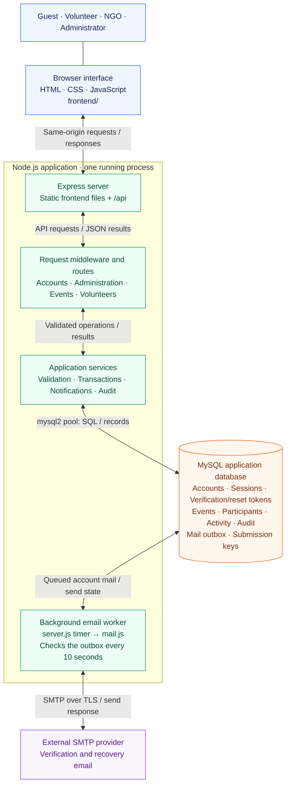
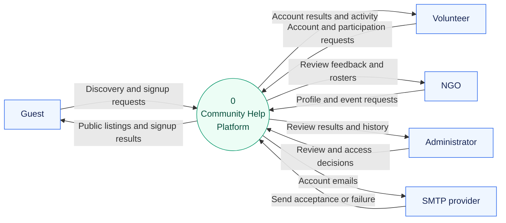
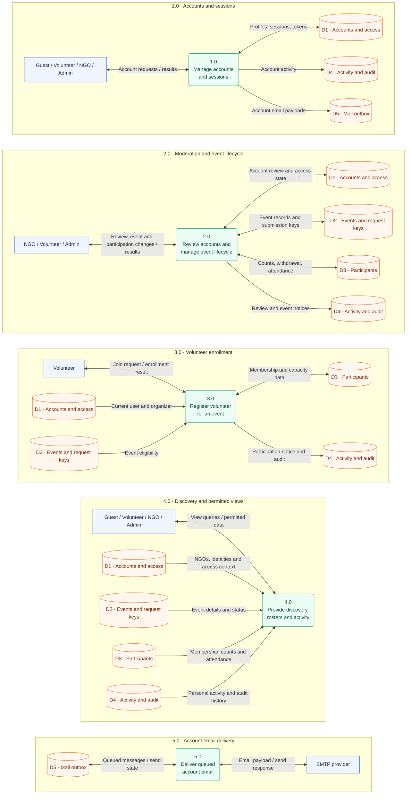
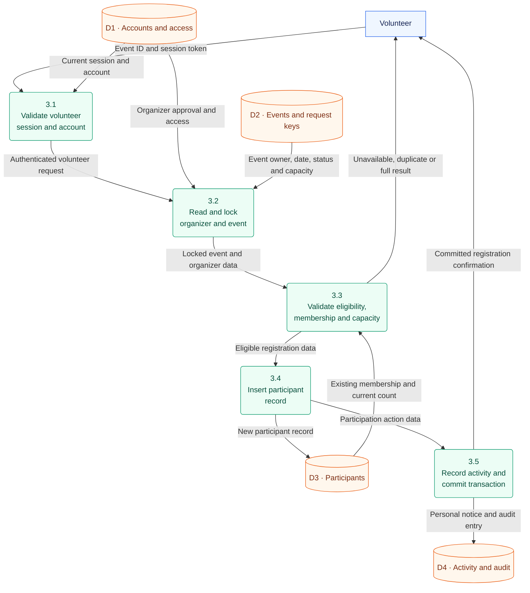
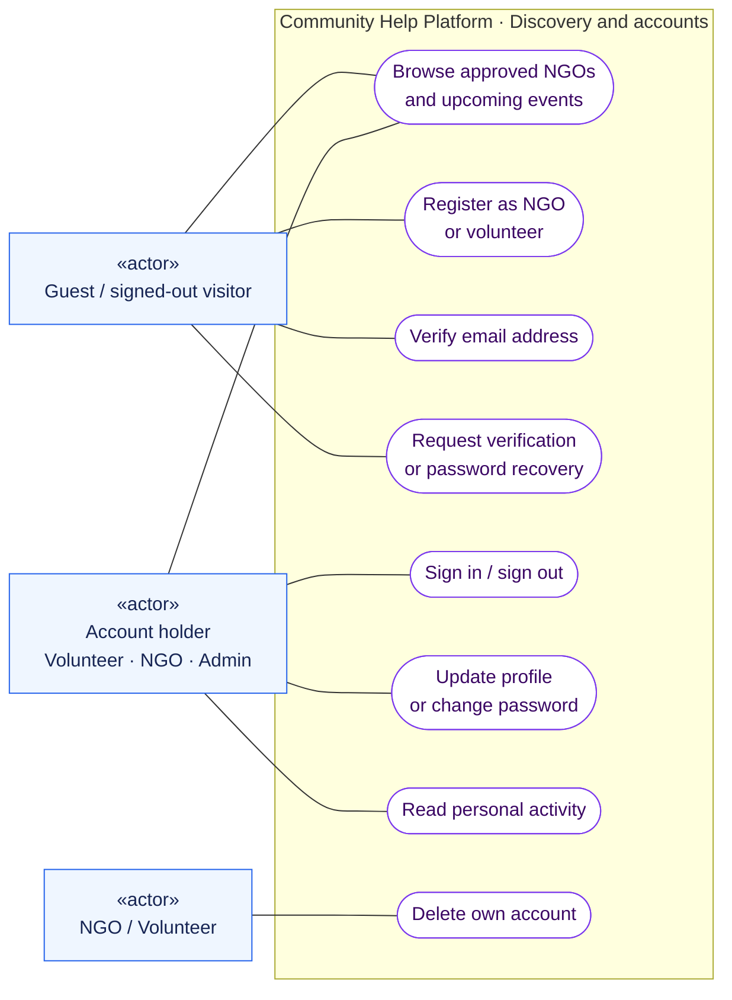
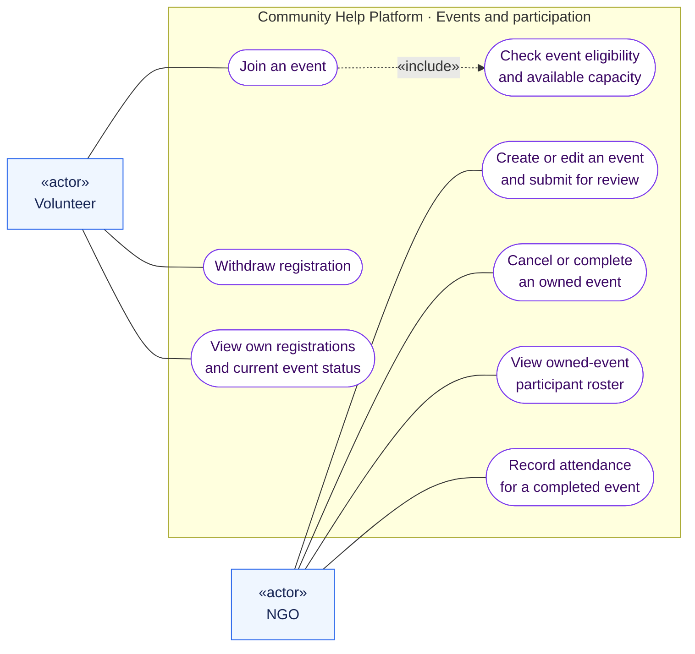
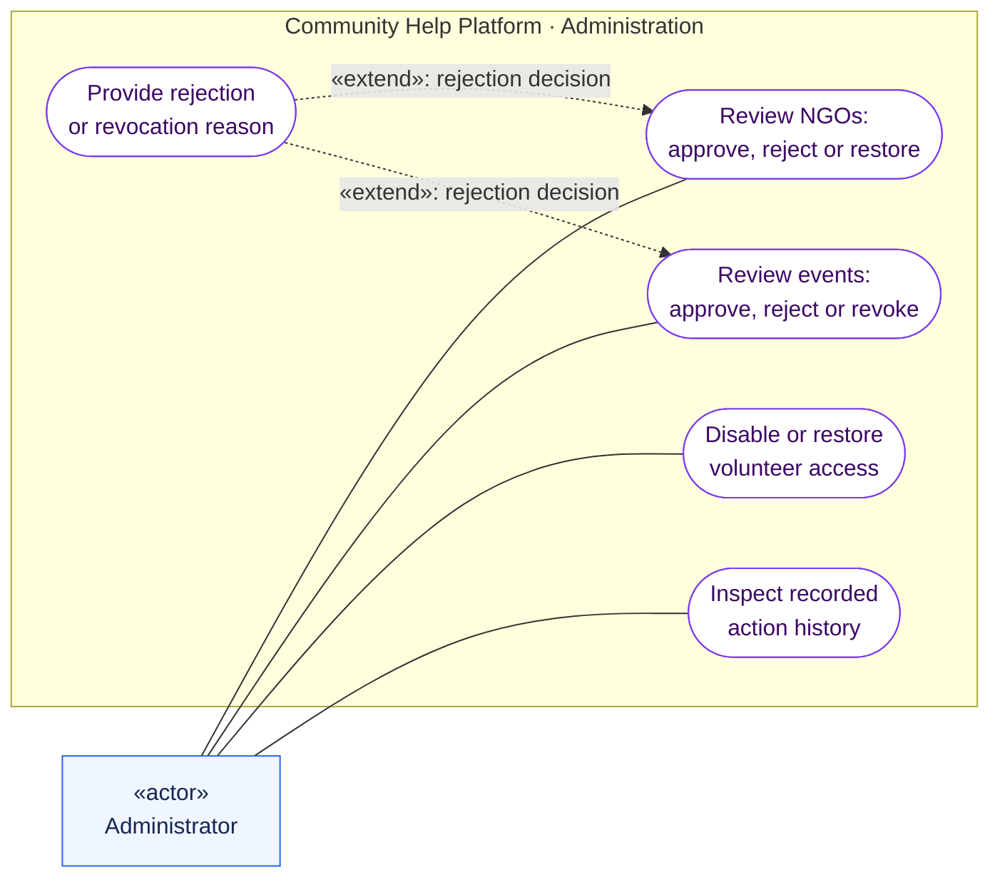

<div align="center">

<h1>🤝 Community Help Platform</h1>

<p><strong>Where local causes become collective action.</strong></p>

<p>Discover a cause. Organize an opportunity. Bring people together.<br>A community platform connecting volunteers, NGOs, and the people who support them.</p>

<p>
  <a href="https://github.com/harsha160507/CommunityHelpPlatform/actions/workflows/ci.yml"></a>
  
  
  
</p>

<p>
  <a href="#features">Explore features</a> ·
  <a href="#system-architecture">Architecture</a> ·
  <a href="#data-flow-diagrams">Data flow</a> ·
  <a href="#use-case-diagrams">Use cases</a> ·
  <a href="#getting-started">Run locally</a> ·
  <a href="#documentation">Documentation</a>
</p>

</div>

---

## The idea

Good intentions need a place to become action. **Community Help Platform** gives NGOs a way to organize local events, volunteers a way to find opportunities, and administrators a way to review what is published.

The result is one connected journey: **discover → review → participate → follow through**.

| For volunteers                                        | For NGOs                                                                      | For administrators                                                               |
| ----------------------------------------------------- | ----------------------------------------------------------------------------- | -------------------------------------------------------------------------------- |
| Find approved opportunities and choose where to help. | Turn community needs into events with clear capacity and participant records. | Review submissions, provide feedback, and keep a traceable history of decisions. |

## Features

|                                  | What you can do                                                                                          |
| -------------------------------- | -------------------------------------------------------------------------------------------------------- |
| 🔎 **Discover opportunities**    | Browse approved upcoming events and the NGO directory, even before creating an account.                  |
| 🏢 **Organize community events** | Create events, set volunteer capacity, submit changes for review, and manage cancellation or completion. |
| 🙌 **Take part**                 | Register for an event, withdraw when plans change, and follow the status of your registrations.          |
| ✅ **Review with context**       | Inspect NGO and event details, approve or reject requests, and provide clear review feedback.            |
| 📋 **Coordinate volunteers**     | View organizer-only participant rosters and record attendance after an event is completed.               |
| 🔔 **Stay informed**             | Receive persistent in-app updates about participation, review decisions, and event changes.              |
| 🔐 **Manage your account**       | Verify your email, recover or change your password, update your profile, and delete your account.        |
| 📊 **See the bigger picture**    | View community counts, personal activity, and administrator review history with paginated lists.         |

### A role for everyone

| Role              | Main capabilities                                                                |
| ----------------- | -------------------------------------------------------------------------------- |
| **Guest**         | Explore approved NGOs and upcoming events.                                       |
| **Volunteer**     | Join or withdraw from events, track registrations, and manage an account.        |
| **NGO**           | Submit events, manage participants, update event details, and record attendance. |
| **Administrator** | Review NGOs and events, manage volunteer access, and inspect action history.     |

## System architecture

A browser-based frontend and an Express API share one origin. MySQL stores application records, while a background worker sends verification and recovery email through SMTP.

### Component architecture



**One application, two execution paths:** browser requests pass through the Express routes and application services; the email worker reads the same database's outbox independently. Both run in the **same Node.js process**, using one shared MySQL connection pool.

- **Frontend:** Express serves the HTML, CSS, and JavaScript; the browser calls the same origin's `/api` endpoints.
- **API:** input validation, current-session checks, role permissions, and domain rules protect the relevant operations. Public discovery remains available without login.
- **Database:** transactions persist accounts, sessions, events, enrollment, activity, and queued account email.
- **Email worker:** a ten-second timer processes verification/recovery mail through SMTP and records send attempts. Development mail preview replaces SMTP sending.
- **Activity:** personal notifications are stored in MySQL and read through the API; the overview refreshes every 30 seconds while visible.

[Editable architecture source](docs/diagrams/system-architecture.mmd) · [Component and process guide](docs/SYSTEM-DESIGN.md#system-architecture)

### Layer responsibilities

| Layer              | Responsibility                                                                     | Implementation                                             |
| ------------------ | ---------------------------------------------------------------------------------- | ---------------------------------------------------------- |
| **Presentation**   | Public discovery, account screens, event management, and role-based dashboards.    | HTML, CSS, JavaScript in `frontend/`.                      |
| **Application**    | Authentication, role checks, validation, reviews, enrollment, and permitted views. | Express routes and services in `backend/src/`.             |
| **Persistence**    | Accounts, hashed sessions/tokens, events, participants, activity, and queued mail. | MySQL with versioned migrations in `database/migrations/`. |
| **Email delivery** | Read queued account messages, send through SMTP, and record retries or acceptance. | `backend/src/mail.js`.                                     |

The diagrams below describe the implemented project. The [system-design guide](docs/SYSTEM-DESIGN.md) maps processes to code, explains the data stores, and records the diagram boundaries.

## Data flow diagrams

Read these diagrams as **data moving between people, processes, and stores**. Process numbers remain consistent between levels; they are not execution-step numbers.

**Legend:** blue rectangles = external actors · green nodes = processes · orange cylinders = logical data stores. A two-headed link abbreviates read/write or request/response flows named on that link.

### Level 0 — The platform in its environment

The context diagram treats the entire application as one process. It shows what guests, volunteers, NGOs, administrators, and the SMTP provider exchange with it.



### Level 1 — The five platform processes

The context process expands into account management, moderation/event lifecycle, enrollment, discovery/permitted views, and email delivery.

The panels reuse the **same D1–D5 stores** for readability; repeated store labels are references to shared records, not separate databases. Actor labels identify possible callers—each operation still enforces its own role permissions.



| Store                            | Records represented                                           |
| -------------------------------- | ------------------------------------------------------------- |
| **D1 · Accounts and access**     | `chp_users`, `chp_sessions`, `chp_account_tokens`.            |
| **D2 · Events and request keys** | `chp_events`, `chp_event_requests`.                           |
| **D3 · Participants**            | `chp_event_participants`, including attendance.               |
| **D4 · Activity and audit**      | `chp_notifications`, `chp_audit_log`.                         |
| **D5 · Mail outbox**             | `chp_mail_outbox`, including send attempts and message state. |

### Level 2 — Inside volunteer enrollment

This level decomposes **process 3.0** into the checks and writes behind joining an event. It retains the parent process's volunteer actor, enrollment result, and D1–D4 stores.



**The enrollment guarantee:** an active, verified volunteer can join only an approved future event from an approved, active NGO, once, and while capacity remains. Organizer/event locks and one transaction protect the participant record, personal notice, and audit entry. Confirmation is returned only after commit; failures roll back the writes.

Other process families remain at Level 1. Withdrawal, attendance, roster reading, and moderation are documented separately in the [process map and rules](docs/SYSTEM-DESIGN.md).

## Use case diagrams

These UML-style views show **who can do what**, using GitHub-compatible Mermaid shapes: actor boxes outside a system boundary and oval use cases inside it.

**Legend:** solid lines = actor participation · **«include»** = required behavior · **«extend»** = behavior added under a stated condition. Authentication and ownership checks are preconditions for protected operations, rather than a repeated sign-in step.

### 1. Discovery and account access

Guests can explore before registering. Account holders manage their access and personal activity; self-service account deletion is available to NGOs and volunteers.



### 2. Volunteering and NGO event management

Volunteers manage their participation. NGOs manage owned events, participant rosters, and attendance. Joining includes the eligibility/capacity check; event creation and edits remain subject to review.



### 3. Administration and review

Administrators review NGOs and events, manage volunteer access, and inspect recorded actions. Rejecting or revoking approval adds the required reason to the decision.



<details>
<summary><strong>Permission and lifecycle details</strong></summary>

- Volunteers must verify their email before signing in. NGOs must also be approved before creating or editing events.
- Rejected NGOs may sign in to correct and resubmit their profile.
- Public browsing exposes only approved, scheduled, future events from active approved NGOs.
- Volunteers may withdraw from unavailable or cancelled events; completed attendance records remain.
- An NGO can read only its own participant rosters. Recording attendance also requires an approved organizer and a completed event.
- Cancellation and completion are distinct actions with different eligibility rules.
- Administrator review uses the current record version/status to prevent stale decisions.

See [API permissions](docs/API.md) and [diagram scope](docs/SYSTEM-DESIGN.md) for the exact boundaries.

</details>

## Getting started

### Prerequisites

- **Node.js:** 22.13+, 24, or 26.
- **MySQL:** 8.0 or later with InnoDB.
- **Git** and a modern web browser.

### 1. Clone and install

```sh
git clone https://github.com/harsha160507/CommunityHelpPlatform.git
cd CommunityHelpPlatform
npm ci
```

### 2. Prepare MySQL

Create the application database from a MySQL administrator session:

```sql
CREATE DATABASE community_help
  CHARACTER SET utf8mb4
  COLLATE utf8mb4_unicode_ci;
```

Create a dedicated database user and grant it access to this database. The account used for migrations needs schema permissions. For production, use a separate runtime account with only the permissions described in the [deployment guide](docs/DEPLOYMENT.md).

### 3. Configure the environment

Copy `.env.example` to `.env`:

```sh
# macOS / Linux
cp .env.example .env
```

```powershell
# Windows PowerShell
Copy-Item .env.example .env
```

Fill in your own database credentials and review these settings:

| Setting                  | Purpose                                                                 |
| ------------------------ | ----------------------------------------------------------------------- |
| `DB_HOST`, `DB_PORT`     | Your MySQL server address and port.                                     |
| `DB_USER`, `DB_PASSWORD` | Your dedicated database account credentials.                            |
| `DB_NAME`                | The database you created, such as `community_help`.                     |
| `BASE_URL`               | The application origin; locally, `http://localhost:3000`.               |
| `EVENT_TIMEZONE`         | The IANA timezone used for events, such as `Asia/Kolkata`.              |
| `DEV_MAIL_PREVIEW`       | Set to `true` for local verification and password-reset email previews. |

**Keep real credentials in your local environment or hosting configuration. Never commit `.env`.**

### 4. Initialize the database and administrator

```sh
npm run migrate
```

Set `ADMIN_EMAIL` and a unique, strong `ADMIN_PASSWORD` in your local environment or `.env`, then run:

```sh
npm run admin:setup
```

There are **no default administrator credentials**. Remove the bootstrap variables afterward. Running this command for an existing administrator resets its password and revokes its sessions.

### 5. Start the application

```sh
npm start
```

Open **[http://localhost:3000](http://localhost:3000)** in your browser.

For backend development with automatic restarts:

```sh
npm run dev
```

The server serves both the interface and `/api`. Open the application URL rather than the HTML file directly.

### Verify a local account

New accounts must verify their email before signing in. With development mail preview enabled, register an account and run:

```sh
npm run mail:preview
```

Open the verification link printed in your terminal. NGO accounts also need administrator approval before creating events.

Production uses SMTP instead of development previews. See the [deployment guide](docs/DEPLOYMENT.md) for delivery settings.

## Project structure

```text
CommunityHelpPlatform/
├── backend/
│   ├── src/
│   │   ├── routes/          # Account, admin, event and volunteer endpoints
│   │   ├── app.js           # Application assembly and security middleware
│   │   ├── server.js        # Startup, background mail and shutdown
│   │   ├── db.js            # MySQL access and transactions
│   │   └── validation.js    # Input and timezone rules
│   └── scripts/             # Migrations, admin setup and mail preview
├── database/
│   └── migrations/          # Versioned schema changes
├── frontend/                # HTML, CSS and browser JavaScript
├── tests/
│   ├── unit/                # Validation and configuration
│   ├── integration/         # Real-MySQL workflows and concurrency
│   └── e2e/                 # Browser and accessibility checks
├── docs/                    # API, deployment and maintenance guides
├── scripts/                 # Source and import checks
├── .github/                 # CI, dependency updates and issue templates
├── .env.example             # Configuration template
└── package.json             # Dependencies and project commands
```

## How events and accounts work

- **Approval comes first.** Public opportunities require an approved, active NGO and an approved scheduled event.
- **Registration closes at the start.** Events must begin in the future, with capacity between 1 and 10,000. Capacity is checked transactionally when volunteers join.
- **Times have a clear meaning.** Events use one configured timezone and same-day start/end times. Date-only values stay in `YYYY-MM-DD` format; ambiguous or nonexistent daylight-saving times are rejected.
- **Changes get reviewed.** NGO profile changes trigger NGO re-review; event edits trigger event re-review. Capacity cannot drop below existing registrations.
- **Participants can follow changes.** Cancellation and review status remain visible in registered events, with updates in personal activity. Volunteers can withdraw from unavailable events; completed attendance records are retained.
- **Account access is revocable.** Sessions expire after 12 hours and are revoked by logout, password changes/resets, or account disabling. Passwords require at least 12 characters and at most 72 UTF-8 bytes.
- **Participant contact details stay with the organizer.** Joining shares those details with the event's NGO.
- **Deletion removes identity fields.** Historical event/audit records remain, and scheduled NGO events are cancelled. Administrator deletion and email-address corrections are operator-managed.

## Quality checks

Run the standard checks:

```sh
npm run check
npm run lint
npm run format:check
npm test
npm audit --audit-level=high
```

For database and browser checks, create a **disposable database** whose name ends in `_test`, configure its `DB_*` settings, and set `ALLOW_TEST_DB_RESET=1`.

```sh
npm run test:integration
npx playwright install chromium
npm run test:e2e
```

> [!WARNING]
> Integration tests erase all tables in the configured test database. Never use your development or production database. Run browser tests after integration tests; they reuse that schema and start a local server on port 33418.

CI covers Node.js **22, 24, and 26** with MySQL. Browser checks run on Node.js 24 and include automated desktop/mobile accessibility checks.

## Documentation

| Guide                                                  | What you will find                                                                        |
| ------------------------------------------------------ | ----------------------------------------------------------------------------------------- |
| [System design & diagram guide](docs/SYSTEM-DESIGN.md) | Process-to-code mapping, store dictionary, and diagram notation and scope.                |
| [API reference](docs/API.md)                           | Endpoints, authentication, pagination, responses, and role permissions.                   |
| [Deployment & maintenance](docs/DEPLOYMENT.md)         | Production setup, SMTP, migrations, monitoring, backups, and recovery.                    |
| [Fix report](docs/FIX-REPORT.md)                       | The 36 audit findings, implemented improvements, validation, and remaining owner actions. |
| [Security response](docs/SECURITY-RESPONSE.md)         | Required steps for credentials exposed by earlier versions.                               |
| [Contributing](CONTRIBUTING.md)                        | Development expectations and the contribution workflow.                                   |
| [Security policy](SECURITY.md)                         | How to report security concerns responsibly.                                              |

<details>
<summary><strong>Upgrading an existing installation?</strong></summary>

Back up your database and read the [deployment guide](docs/DEPLOYMENT.md) before applying migrations.

- Existing accounts must verify their email.
- Legacy administrator accounts remain disabled until explicitly reset with `npm run admin:setup`.
- Previous JWT sessions are no longer accepted.
- Any credentials exposed in earlier commits must be rotated at the actual services. Removing a file does not remove historical copies or invalidate a password.
- Production requires HTTPS, configured SMTP, and a dedicated database account.

</details>

## Contributing

Have an improvement or a reproducible bug to share? Read [CONTRIBUTING.md](CONTRIBUTING.md), open an issue, or propose a focused pull request.

Please keep credentials and personal information out of public reports.

## License

This project currently reserves its rights under [LICENSE](LICENSE); it does not grant an open-source distribution license. Third-party dependencies retain their respective licenses.

---

<div align="center">
  <strong>A little time. A shared purpose. A stronger community.</strong>
</div>
